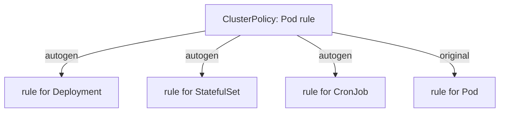

# Autogen: Pod Rules for Pod Controllers

Nobody launches a Pod by hand in production. A Deployment launches a ReplicaSet, and the ReplicaSet launches the Pods. In this part you will see that Kyverno knows this, and rewrites your Pod rule so it also checks the Deployment, before any Pod exists.

## One rule, many kinds

A Pod rule is a flight check at the Pod's airlock. A Deployment is the fleet order that comes before it. If the check waits for the airlock, the fleet order is accepted, and the failure shows up later as Pods that never start. That is hard to debug. Kyverno avoids this with **autogen** (short for automatic generation): when a policy matches `Pod`, Kyverno adds matching rules for the kinds that contain a Pod template.

Those kinds are `Deployment`, `StatefulSet`, `DaemonSet`, `Job`, `ReplicaSet` and `ReplicationController`. A `CronJob` gets its own rule too, because its template sits one level deeper. The generated rule checks the Pod template inside the object, for example `spec.template.metadata.labels` in a Deployment.

## See it in your playground

<!-- astrona:playground:renew -->

Save this as `clusterpolicy-require-pod-team-label.yaml`:

```yaml
apiVersion: kyverno.io/v1
kind: ClusterPolicy
metadata:
  name: require-pod-team-label
spec:
  validationFailureAction: Enforce
  background: true
  rules:
    - name: check-team-label
      match:
        any:
          - resources:
              kinds:
                - Pod
              namespaces:
                - shop
      validate:
        message: "Every Pod in shop must carry a team label."
        pattern:
          metadata:
            labels:
              team: "?*"
```

Apply it:

```sh
kubectl apply -f clusterpolicy-require-pod-team-label.yaml
```

The policy names only `Pod`. Now try to create a Deployment, whose Pod template has no `team` label:

```sh
kubectl create deployment web --image=registry.k8s.io/pause:3.9 -n shop
```

The request is denied. The Deployment was rejected, not just its Pods. The message quotes the rule name `autogen-check-team-label`. That `autogen-` prefix tells you the denial came from the copy Kyverno wrote for Deployments, not from your original rule. Warnings about the deprecated `ClusterPolicy` kind are normal on this version.

## Read the generated rule

Kyverno adds an annotation to the policy that lists the kinds it covers:

```sh
kubectl get clusterpolicy require-pod-team-label -o jsonpath='{.metadata.annotations}'
```

Look for the key `pod-policies.kyverno.io/autogen-controllers`. When you do not set it, Kyverno fills in the full list. The generated rules themselves live in the policy status, so `kubectl get clusterpolicy require-pod-team-label -o yaml` shows them under `status`.



One Pod rule becomes a family of rules, each aimed at the right place inside its kind.

## Choose which kinds to cover

If you want to turn autogen off, or limit it, set the annotation yourself. The value `none` turns it off. A comma list such as `Deployment,StatefulSet` limits it.

```sh
kubectl annotate clusterpolicy require-pod-team-label pod-policies.kyverno.io/autogen-controllers=none --overwrite
```

After this, the policy checks only bare Pods, and a Deployment with no `team` label in its template would be admitted. Use this only when you mean it. Remove the annotation to bring autogen back.

```sh
kubectl annotate clusterpolicy require-pod-team-label pod-policies.kyverno.io/autogen-controllers-
```

> [!TIP]
> When a policy denies a Deployment and you cannot find the rule in your file, search the denial message for `autogen-`. The rule you wrote is the part after the prefix.

## Common pitfalls

> [!WARNING]
> **Common pitfalls**
>
> - **Writing a second rule for Deployments by hand.** Autogen already does it. A duplicate makes every denial appear twice.
> - **Expecting autogen when the rule names a Pod field that has no Deployment twin.** A rule that matches by Pod `names`, or uses the `request.object.spec.nodeName` field, cannot be copied, so Kyverno skips autogen for it.
> - **Forgetting that autogen only checks the template.** A Deployment whose template has the label is admitted, even if you later edit a running Pod by hand.
