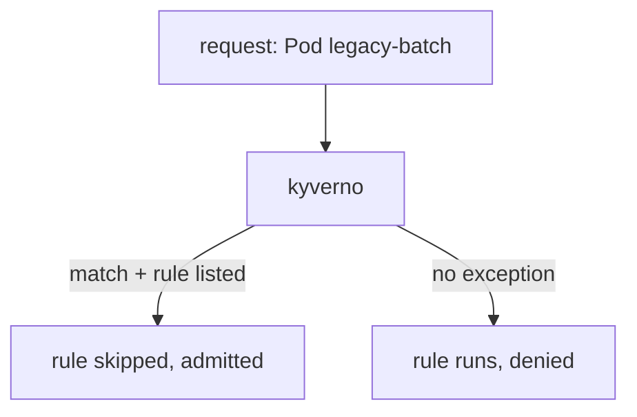

# Policy Exceptions

Some rules need one honest exception. A legacy batch Pod cannot carry the new label until the next release. In this part you will let that one Pod skip that one rule, while every other Pod still obeys it.

## Why not edit the policy?

You could add an `exclude` block to the policy. That works, but it changes the policy itself. The platform team owns the policy, and the application team owns the Pod. A **`PolicyException`** is a separate object that says "this resource may skip these rules of this policy". It is like a signed pass from mission control. The rule stays the same, and the pass is easy to find, review and delete.

## Exceptions are off by default

A `PolicyException` can weaken a rule, so Kyverno ignores them unless an administrator switches the feature on. In the Helm chart, the switch is `features.policyExceptions.enabled`. The playground already has it on. You can also limit which namespace may hold exceptions with `features.policyExceptions.namespace`. When that is empty, an exception in any namespace is accepted.

## See it in your playground

<!-- astrona:playground:renew -->

The commands below need the `require-pod-team-label` `ClusterPolicy` applied, which requires a `team` label on Pods in `shop`. First prove the rule blocks a Pod without the label:

```sh
kubectl run legacy-batch --image=registry.k8s.io/pause:3.9 -n shop
```

The request is denied by `check-team-label`. Now save this as `policyexception-legacy-batch.yaml`:

```yaml
apiVersion: kyverno.io/v2
kind: PolicyException
metadata:
  name: legacy-batch
  namespace: shop
spec:
  exceptions:
    - policyName: require-pod-team-label
      ruleNames:
        - check-team-label
  match:
    any:
      - resources:
          kinds:
            - Pod
          namespaces:
            - shop
          names:
            - legacy-batch
```

Apply it:

```sh
kubectl apply -f policyexception-legacy-batch.yaml
```

Then try the same Pod again, and a second Pod with another name:

```sh
kubectl run legacy-batch --image=registry.k8s.io/pause:3.9 -n shop
kubectl run other-batch --image=registry.k8s.io/pause:3.9 -n shop
```

`legacy-batch` is admitted. `other-batch` is still denied. The exception names one policy, one rule and one Pod name, so nothing else gets through.

## What the fields mean

`spec.exceptions` lists pairs of a policy name and the rule names to skip. `spec.match` picks the resources. It has the same shape as `match` in a policy, so you can use names, namespaces and selectors. The two lists work together: a resource skips a rule only if it matches here and the rule is listed.



Kyverno looks for a matching exception before it runs each rule.

> [!NOTE]
> To skip the autogen copy for a Deployment too, list its name in `ruleNames`. For the rule above that is `autogen-check-team-label`.

## Clean up the exception

Delete the pass when the legacy Pod is fixed:

```sh
kubectl delete policyexception legacy-batch -n shop
```

From now on `legacy-batch` is blocked again if you try to create it.

## Your mission: Autogen and Exceptions Lab

You can now apply a rule to Deployments through autogen and carve out one named Pod with an exception. The mission asks you to do both on a fresh cluster.

First pause the playground:

```sh
astrona stop section-010-module-04-playground
```

Then run the mission and submit your work:

```sh
astrona run --git git@github.com:astrona-io/ATS007.git -c sections/section-010/module-04/labs/lab-01
astrona submit
```

When you are done, remove the mission and start the playground again:

```sh
astrona destroy ats-007-lab-015
astrona start section-010-module-04-playground
```

## Common pitfalls

> [!WARNING]
> **Common pitfalls**
>
> - **Creating an exception while the feature is off.** Kyverno accepts the object but ignores it, and the Pod is still denied. Check the Helm value first.
> - **Listing the policy but not the rule.** The exception needs `ruleNames`. Without the right rule name it skips nothing.
> - **Using a wide `match`.** An exception that matches every Pod in a namespace is a hole in the policy. Name the object.
> - **Forgetting the `autogen-` rule.** An exception for a Pod does not cover the Deployment that makes it.
