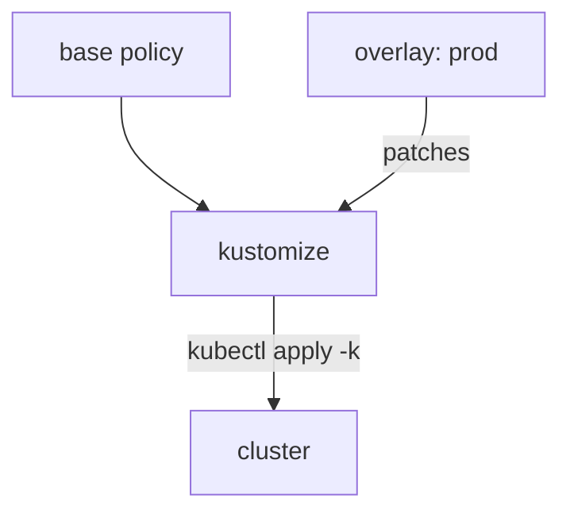

# Kustomize Overlays for Policies

One policy must run in `Audit` on the test cluster and in `Enforce` in production. Copying the file twice means fixing every bug twice. Kustomize, a tool built into `kubectl`, lets you keep one base and write only the differences.

## Base and overlay

A **base** is the complete file. An **overlay** is a small folder that points at the base and says "change these fields". Think of the base as the standard ship blueprint, and each overlay as the notes for one mission. `kubectl kustomize <folder>` reads a folder's `kustomization.yaml`, builds the result and prints it. It does not touch the cluster.

## See it in your playground

<!-- astrona:playground:renew -->

Build the base and look at the printed policy:

```sh
cd /root/playground
kubectl kustomize base
```

The output matches the file on disk. Now save this as `overlays/prod/kustomization.yaml`:

```yaml
apiVersion: kustomize.config.k8s.io/v1beta1
kind: Kustomization
resources:
  - ../../base
labels:
  - pairs:
      environment: prod
patches:
  - target:
      kind: ClusterPolicy
      name: require-owner-label
    patch: |-
      - op: replace
        path: /spec/validationFailureAction
        value: Enforce
      - op: replace
        path: /metadata/annotations/policies.kyverno.io~1severity
        value: high
```

The patch uses a JSON Patch list. In a path, the slash inside the annotation key is written `~1`. The `labels` block adds `environment: prod` to the object.

## Preview, then apply

Build the overlay to see the result:

```sh
kubectl kustomize overlays/prod
```

The output shows `validationFailureAction: Enforce`, the `high` severity and the new label. The base file is unchanged. Next compare it with the live policy from the base:

```sh
kubectl diff -k overlays/prod
```

The diff lists the lines that would change. `kubectl diff` exits with code 1 when there are differences. That is normal. Apply the overlay:

```sh
kubectl apply -k overlays/prod
```

Then check the result:

```sh
kubectl get clusterpolicy require-owner-label -o jsonpath='{.spec.validationFailureAction}'
```

It prints `Enforce`.



The overlay never edits the base. Kustomize merges them when it builds.

## Your mission: Policy Overlay Lab

You can now build and apply a policy from a base and an overlay. The mission asks you to write an overlay for a fresh base.

First pause the playground:

```sh
astrona stop section-020-module-04-playground
```

Then run the mission and submit your work:

```sh
astrona run --git git@github.com:astrona-io/ATS007.git -c sections/section-020/module-04/labs/lab-01
astrona submit
```

When you are done, remove the mission and start the playground again:

```sh
astrona destroy ats-007-lab-016
astrona start section-020-module-04-playground
```

## Common pitfalls

> [!WARNING]
> **Common pitfalls**
>
> - **Running `kubectl apply -f` on the overlay folder.** Use `-k`. With `-f` the cluster gets the raw `kustomization.yaml`, which is not a Kubernetes object.
> - **A wrong `~1` in the patch path.** If the path is wrong the build fails with a message that names the path.
> - **Editing the base to fix one cluster.** Then every other cluster changes too. Change the overlay.
> - **Reading a diff exit code of 1 as an error.** It only means there are differences.
