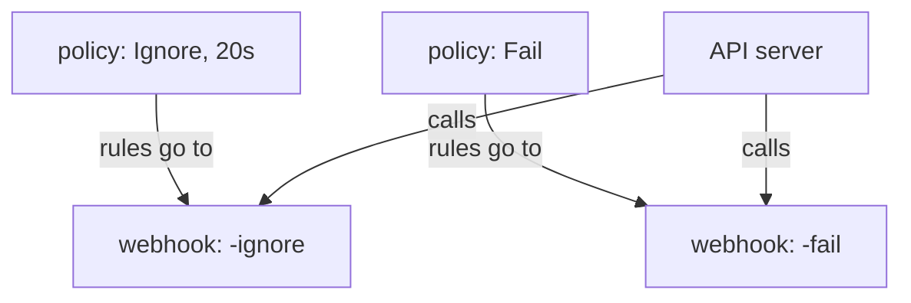

# Failure Policy and Timeouts

Imagine mission control goes silent while a ship waits at the airlock. You can order the airlock to stay shut, or to open. In this part you will set that order for each policy, and see it land in the cluster.

## Two dials on a policy

`spec.failurePolicy` says what the API server does when it cannot get an answer from Kyverno. The value `Fail` (the default) rejects the request. The value `Ignore` lets it through. `spec.webhookTimeoutSeconds` says how long the API server waits for the answer. The range is 1 to 30 seconds and the default is 10.

Choose `Fail` for rules that guard safety, because a gap is worse than an outage. Choose `Ignore` for helpful rules, such as labels, where a short gap does no harm.

## See it in your playground

<!-- astrona:playground:renew -->

Save this as `clusterpolicy-require-secret-owner.yaml`:

```yaml
apiVersion: kyverno.io/v1
kind: ClusterPolicy
metadata:
  name: require-secret-owner
spec:
  validationFailureAction: Enforce
  failurePolicy: Ignore
  webhookTimeoutSeconds: 20
  background: true
  rules:
    - name: check-owner-label
      match:
        any:
          - resources:
              kinds:
                - Secret
              namespaces:
                - vault
      validate:
        message: "Every Secret in vault needs an owner label."
        pattern:
          metadata:
            labels:
              owner: "?*"
```

Apply it:

```sh
kubectl apply -f clusterpolicy-require-secret-owner.yaml
```

Then read the webhook names and failure policies Kyverno wrote:

```sh
kubectl get validatingwebhookconfiguration kyverno-resource-validating-webhook-cfg -o jsonpath='{range .webhooks[*]}{.name}{" "}{.failurePolicy}{" "}{.timeoutSeconds}{"\n"}{end}'
```

Kyverno keeps one webhook per failure policy. Their names end in `-fail` and `-ignore`. Your policy asked for `Ignore`, so the `-ignore` webhook now has a rule for `secrets`, and its timeout is 20. A webhook with no rules does nothing, which is why the `-fail` one stays empty until a `Fail` policy needs it.



Kyverno sorts policies into the webhook that matches their dials. If one webhook times out, the failure policy of that webhook decides.

## Prove the rule still works

While Kyverno is healthy, `Ignore` changes nothing about the rule. Try an unlabelled Secret:

```sh
kubectl create secret generic db-pass --from-literal=password=moon -n vault
```

The request is denied by `check-owner-label`. The failure policy is only used when Kyverno cannot answer.

> [!TIP]
> Always test the "Kyverno is down" case for a policy you mark `Ignore`. Scale the admission controller to zero in a test cluster and confirm the object is admitted. A setting you never tried is a guess.

## Your mission: Failure Policy Lab

You can now set the two dials and read them back from the webhook. The mission asks you to build a policy with both dials set and prove it still blocks.

First pause the playground:

```sh
astrona stop section-030-module-03-playground
```

Then run the mission and submit your work:

```sh
astrona run --git git@github.com:astrona-io/ATS007.git -c sections/section-030/module-03/labs/lab-01
astrona submit
```

When you are done, remove the mission and start the playground again:

```sh
astrona destroy ats-007-lab-017
astrona start section-030-module-03-playground
```

## Common pitfalls

> [!WARNING]
> **Common pitfalls**
>
> - **Marking a security rule `Ignore` to avoid outages.** An attacker only needs Kyverno to be slow. Use `Fail` for rules that guard safety.
> - **Setting a long timeout.** The API server's own client waits too. A 30 second hold on every Secret write makes `kubectl` feel frozen.
> - **Looking for the dial in the wrong place.** Both fields sit under `spec`, not under a rule.
