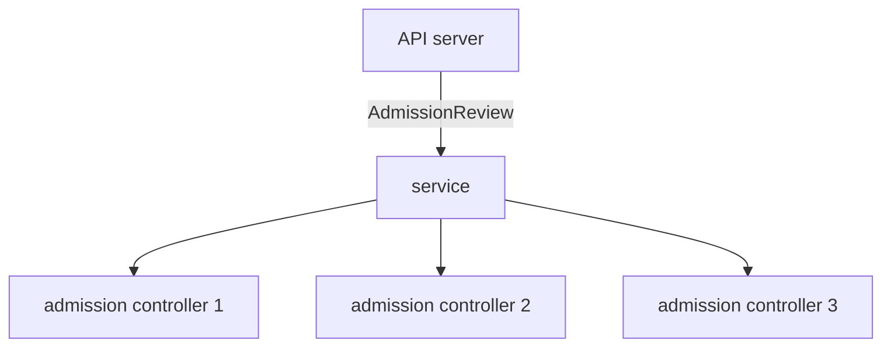

# Resource Filters and Availability

Some objects never reach Kyverno, and some outages come from Kyverno itself. In this part you will read the list of skipped objects, then look at the settings that keep the admission controller running.

## Resource filters: what Kyverno skips

**Resource filters** are a list of kinds, namespaces and names that Kyverno ignores, even when a policy matches them. The list lives in a `ConfigMap` called `kyverno` in the `kyverno` namespace, under the key `resourceFilters`. It exists to stop Kyverno from checking busy or sensitive internal objects, such as Events, Nodes and the control-plane namespaces. It is like a list of ships that are always waved through without a check.

## See it in your playground

<!-- astrona:playground:renew -->

Read the list:

```sh
kubectl get configmap kyverno -n kyverno -o jsonpath='{.data.resourceFilters}'
```

Each entry has the form `[Kind,Namespace,Name]` with `*` as a wildcard. Look for entries that name `kyverno` and `kube-system`. Your own list may differ a little between chart versions, so trust what the command prints. Now check the namespace selector on the webhook:

```sh
kubectl get validatingwebhookconfiguration kyverno-resource-validating-webhook-cfg -o jsonpath='{.webhooks[0].namespaceSelector}'
```

If you see an expression that excludes the `kyverno` namespace, Kyverno cannot block its own Pods from restarting. That keeps a bad policy from locking Kyverno out of repairing itself.

> [!NOTE]
> Resource filters are an administrator setting, set in the Helm chart. A policy author cannot change them. If a policy never fires for a kind, check this list before debugging the policy.

## Keep the admission controller available

The admission controller is the part that answers the API server. When it is down, a `Fail` webhook rejects matching requests, and an `Ignore` webhook admits them without a check. Two settings reduce the risk.

First, run more than one replica. The Helm value `admissionController.replicas` sets the count. Three replicas are the usual production choice. Second, keep a `PodDisruptionBudget`, which stops a node drain from taking every replica at once. Look at both:

```sh
kubectl get deployment kyverno-admission-controller -n kyverno
kubectl get pdb -n kyverno
```

The first command shows the ready count. A single-node playground runs a single replica, so the `PodDisruptionBudget` may be absent here, and a real cluster has both.



The service sends each call to a healthy replica, so one crash does not stop admission.

## Common pitfalls

> [!WARNING]
> **Common pitfalls**
>
> - **Debugging a policy for a kind that is filtered.** If the kind is in `resourceFilters`, no policy will ever see it.
> - **Running one replica in production.** Every rollout or node drain then opens a gap.
> - **Editing the ConfigMap by hand in a chart-managed install.** The next Helm upgrade overwrites it. Change the Helm values.
