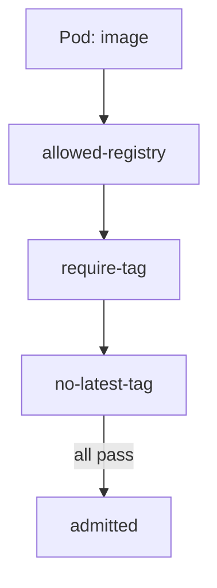

# Registry and Tag Rules

A ship should only dock at trusted bases. An image should only come from trusted registries. In this part you will write both rules with a plain pattern, and see which Pod they stop.

## Why these two rules

A **registry** is the server that holds images, such as `registry.k8s.io`. If any registry is allowed, anyone can run any code in your cluster. A **tag** is the label after the colon, as in `pause:3.9`. The tag `latest`, and an image with no tag at all, can point to different bytes tomorrow. Two simple rules close both gaps.

## See it in your playground

<!-- astrona:playground:renew -->

Save this as `clusterpolicy-restrict-image-sources.yaml`:

```yaml
apiVersion: kyverno.io/v1
kind: ClusterPolicy
metadata:
  name: restrict-image-sources
spec:
  validationFailureAction: Enforce
  background: true
  rules:
    - name: allowed-registry
      match:
        any:
          - resources:
              kinds:
                - Pod
              namespaces:
                - prod
      validate:
        message: "Images in prod must come from registry.k8s.io."
        pattern:
          spec:
            containers:
              - image: "registry.k8s.io/*"
    - name: require-tag
      match:
        any:
          - resources:
              kinds:
                - Pod
              namespaces:
                - prod
      validate:
        message: "Images in prod must have a tag."
        pattern:
          spec:
            containers:
              - image: "*:*"
    - name: no-latest-tag
      match:
        any:
          - resources:
              kinds:
                - Pod
              namespaces:
                - prod
      validate:
        message: "The latest tag is not allowed in prod."
        pattern:
          spec:
            containers:
              - image: "!*:latest"
```

Apply it:

```sh
kubectl apply -f clusterpolicy-restrict-image-sources.yaml
```

Then test four images. The `--dry-run=server` flag asks the cluster to judge the Pod without creating it:

```sh
kubectl run probe --image=nginx:1.27 -n prod --dry-run=server
kubectl run probe --image=registry.k8s.io/pause -n prod --dry-run=server
kubectl run probe --image=registry.k8s.io/pause:latest -n prod --dry-run=server
kubectl run probe --image=registry.k8s.io/pause:3.9 -n prod --dry-run=server
```

The first is denied by `allowed-registry`. The second is denied by `require-tag`. The third is denied by `no-latest-tag`. The fourth passes every rule and is accepted.

## How the patterns work

In a pattern, `*` stands for any characters, and a leading `!` means "must not match". An array in a pattern, such as `containers`, is checked for every item in it. So one line covers one container or five.



Each rule is checked on its own, so the message tells you which one failed.

## Cover init containers

The pattern above only reads `spec.containers`. Init containers run first and can pull any image. Add them to the same `pattern`, next to `containers`, using `=(initContainers)` so Pods without any are not rejected:

```yaml
pattern:
  spec:
    =(initContainers):
      - image: "registry.k8s.io/*"
```

The `=()` mark means "if the field exists, then check it".

## Your mission: Image Rules Lab

You can now write registry and tag rules and test them with a dry run. The mission asks you to write the same policy on a fresh cluster.

First pause the playground:

```sh
astrona stop section-040-module-03-playground
```

Then run the mission and submit your work:

```sh
astrona run --git git@github.com:astrona-io/ATS007.git -c sections/section-040/module-03/labs/lab-01
astrona submit
```

When you are done, remove the mission and start the playground again:

```sh
astrona destroy ats-007-lab-018
astrona start section-040-module-03-playground
```

## Common pitfalls

> [!WARNING]
> **Common pitfalls**
>
> - **Writing `registry.k8s.io` with no slash and star.** The pattern `registry.k8s.io` matches only that exact string, never an image path.
> - **Forgetting init containers.** A rule on `containers` leaves a gap.
> - **Thinking `!*:latest` forbids untagged images.** An untagged image has no `:latest` in its text, so it passes that rule. Add `require-tag`.
